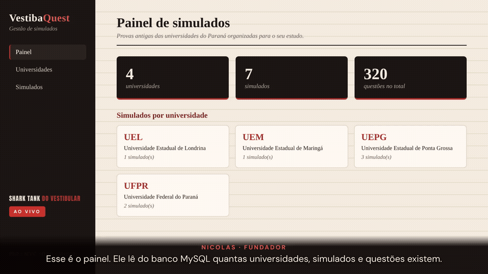
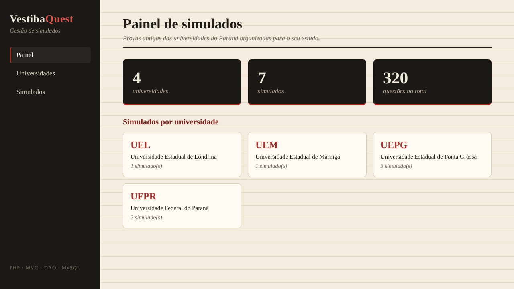
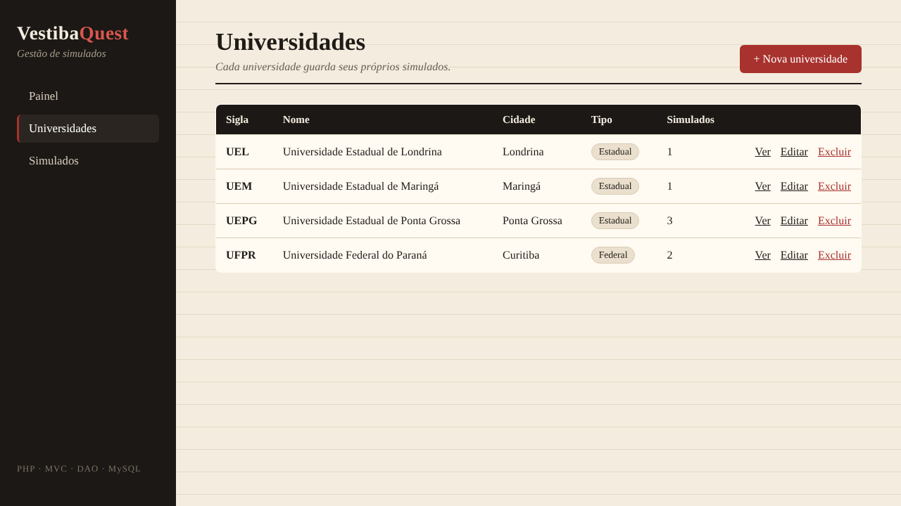
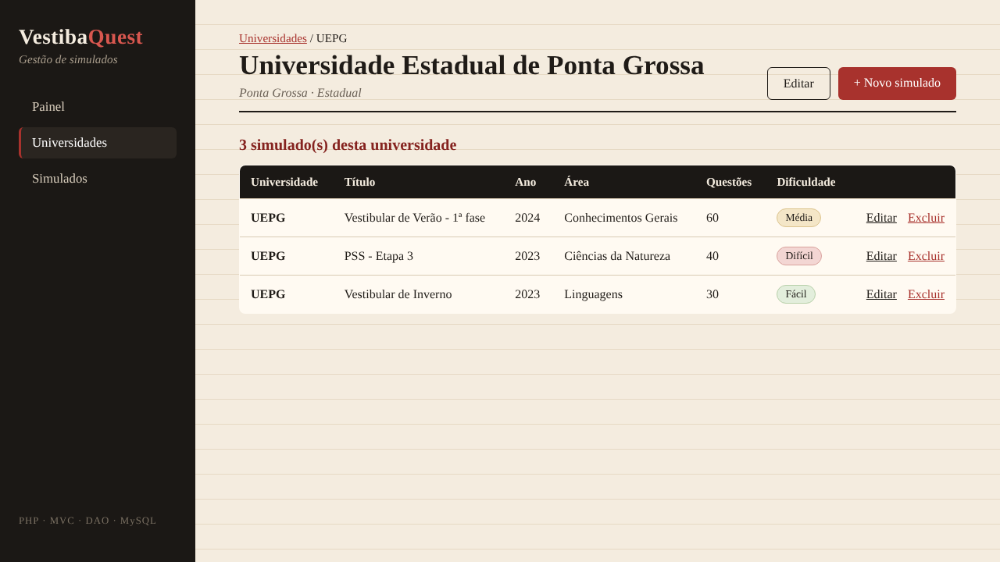
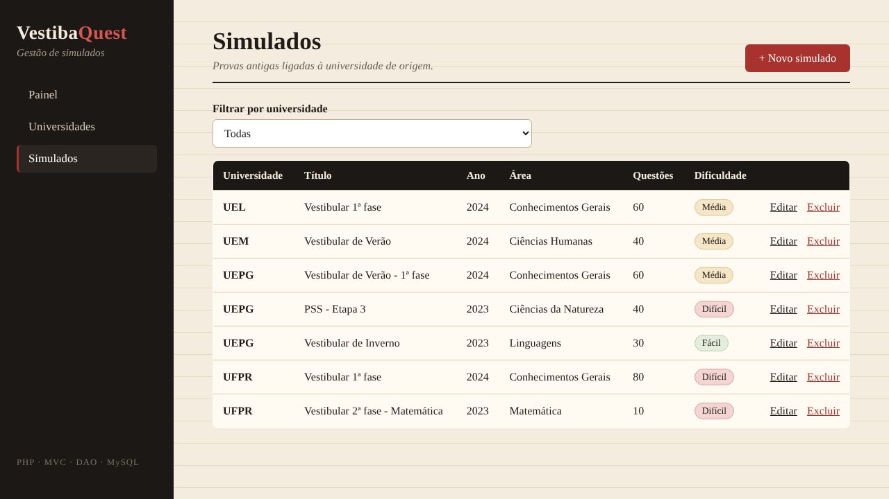
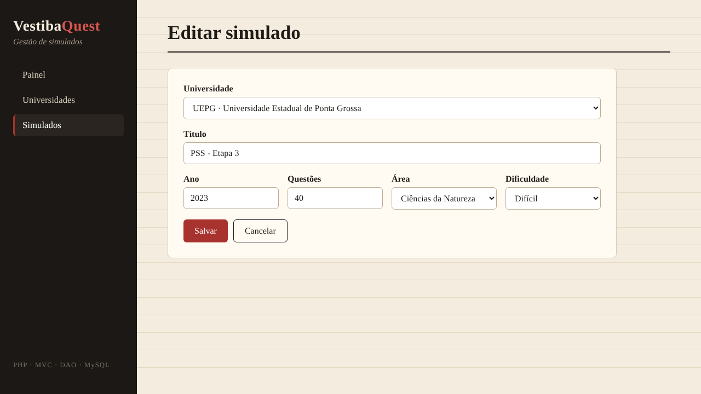
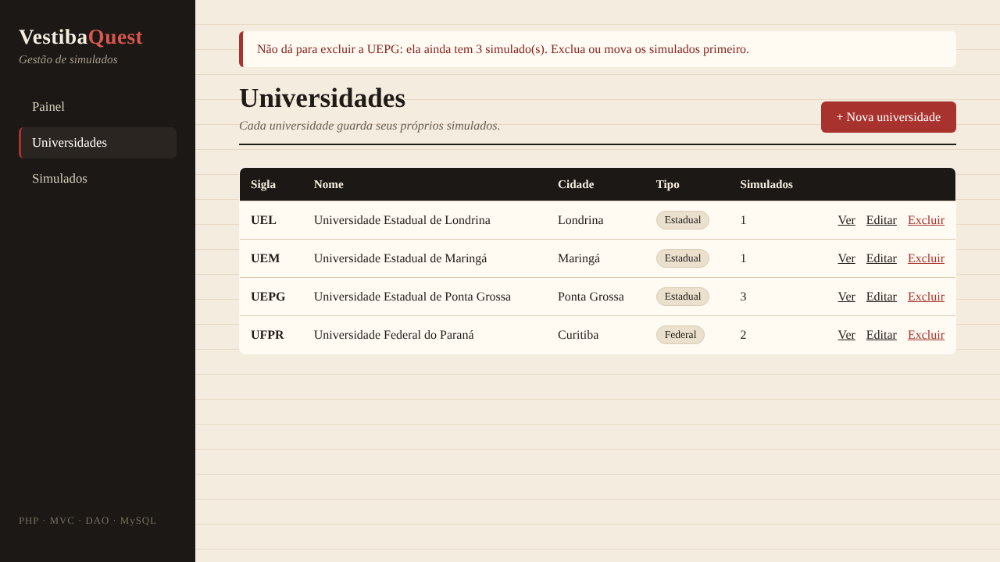

# VestibaQuest · Gestão de Simulados

Aplicação web orientada a objetos em **PHP** que organiza **simulados de vestibular** das universidades do Paraná. É um módulo do VestibaQuest, a startup do projeto integrador, construído com **MVC**, **DAO** e **MySQL**, com CRUD completo em duas tabelas relacionadas:

**Universidade** 1 ──── N **Simulado**

Uma universidade, como a UEPG, possui vários simulados de provas antigas. Cada simulado pertence a exatamente uma universidade por meio da chave estrangeira `simulado.universidade_id`.



## Telas

| Painel | Universidades |
|---|---|
|  |  |

| Universidade com seus simulados | Lista de simulados com filtro |
|---|---|
|  |  |

| Formulário de simulado | Exclusão bloqueada por integridade |
|---|---|
|  |  |

O vídeo de apresentação está em [`docs/video/VestibaQuest_SharkTank_MVC_DAO.mp4`](docs/video/VestibaQuest_SharkTank_MVC_DAO.mp4).

## Integrante

| Nome | R.A. |
|---|---|
| Nicolas | trabalho individual, R.A. dispensado pelo professor |

## Tecnologias

- PHP 8 orientado a objetos, sem framework
- PDO com prepared statements
- MySQL ou MariaDB, via XAMPP
- HTML5 e CSS3 puros na View
- Autoload próprio com `spl_autoload_register`, sem Composer

Não há dependências externas para instalar.

## Como instalar e executar

### Com XAMPP, recomendado

1. Instale o [XAMPP](https://www.apachefriends.org/) e abra o **XAMPP Control Panel**.
2. Inicie **Apache** e **MySQL**.
3. Copie a pasta do projeto para `C:\xampp\htdocs\vestibaquest-mvc`.
   Se baixou o ZIP do GitHub, renomeie a pasta `vestibaquest-mvc-main` para `vestibaquest-mvc`.
4. Acesse `http://localhost/phpmyadmin`, clique em **Importar**, escolha o arquivo `database/vestibaquest_mvc.sql` e clique em **Executar**.
   O script cria o banco `vestibaquest_mvc`, as duas tabelas e dados de exemplo.
5. Abra `http://localhost/vestibaquest-mvc` no navegador.

Se o seu MySQL tiver senha ou outra porta, ajuste `config/config.php`.

### Sem XAMPP, pelo terminal

```bash
mysql -u root -p < database/vestibaquest_mvc.sql
php -S localhost:8080
```

Depois abra `http://localhost:8080`.

## Banco de dados

Script completo em [`database/vestibaquest_mvc.sql`](database/vestibaquest_mvc.sql).

```
universidade                     simulado
─────────────                    ─────────────────────────
id          PK  ◄──────┐         id               PK
nome                   └──────── universidade_id  FK
sigla       UNIQUE               titulo
cidade                           ano
tipo        ENUM                 area
criado_em                        qtd_questoes
                                 dificuldade      ENUM
                                 criado_em
```

A chave estrangeira usa `ON DELETE RESTRICT`. Além disso, o controller confere antes e mostra uma mensagem amigável quando alguém tenta excluir uma universidade que ainda tem simulados.

## Arquitetura

```
vestibaquest-mvc/
├── index.php                      Front controller: recebe a URL e chama o controller
├── config/
│   ├── config.php                 Dados de conexão
│   ├── autoload.php               Carrega classes pelo namespace
│   └── helpers.php                Função e() para escapar HTML
├── app/
│   ├── Model/
│   │   ├── Entity/
│   │   │   ├── Entidade.php       Classe abstrata base, id e validar()
│   │   │   ├── Universidade.php
│   │   │   └── Simulado.php       Guarda também o objeto Universidade dono
│   │   └── Dao/
│   │       ├── Conexao.php        PDO único, padrão Singleton
│   │       ├── DaoInterface.php   Contrato do CRUD
│   │       ├── BaseDao.php        Abstrata, código comum de todos os DAOs
│   │       ├── UniversidadeDao.php
│   │       └── SimuladoDao.php    Consultas com INNER JOIN
│   ├── Controller/
│   │   ├── Controller.php         Abstrata: render, redirecionar, mensagens
│   │   ├── PainelController.php
│   │   ├── UniversidadeController.php
│   │   └── SimuladoController.php
│   ├── View/                      Telas em PHP + HTML, sem SQL
│   │   ├── layout.php
│   │   ├── painel.php
│   │   ├── universidades/         lista, form, ver
│   │   └── simulados/             lista, form, _tabela
│   └── Exception/
│       ├── ValidacaoException.php
│       └── RegraNegocioException.php
├── assets/style.css
├── database/vestibaquest_mvc.sql
└── docs/                          Prints, GIF e vídeo
```

### Como cada camada funciona

- **Model / Entity**: `Universidade` e `Simulado` herdam de `Entidade`, que é abstrata. Os atributos são privados com getters e setters, e cada classe implementa seu próprio `validar()`, lançando `ValidacaoException` com a lista de erros.
- **Model / DAO**: toda a SQL do sistema está aqui. `DaoInterface` define `inserir`, `buscarPorId`, `listarTodos`, `atualizar` e `excluir`. `BaseDao` implementa o que é igual para todas as tabelas, e cada DAO concreto só escreve o que é específico. A conexão vem de `Conexao`, um Singleton com PDO.
- **Controller**: recebe a requisição, monta a entidade com os dados do formulário, chama a validação, aplica as regras de negócio e decide qual View mostrar. Regras implementadas: sigla de universidade não pode repetir, simulado precisa de uma universidade existente e universidade com simulados não pode ser excluída.
- **View**: só exibe os objetos recebidos do controller. Todo texto passa por `e()`, que usa `htmlspecialchars`, para evitar XSS.

### Conceitos de POO aplicados

| Conceito | Onde |
|---|---|
| Encapsulamento | Atributos `private` com getters e setters nas entidades |
| Herança | `Universidade` e `Simulado` estendem `Entidade`; DAOs estendem `BaseDao`; controllers estendem `Controller` |
| Classes abstratas | `Entidade`, `BaseDao`, `Controller` |
| Interface | `DaoInterface` |
| Polimorfismo | `validar()` e `mapear()` com implementação diferente em cada classe filha |
| Composição | `Simulado` contém um objeto `Universidade` |
| Singleton | `Conexao` |
| Exceções próprias | `ValidacaoException`, `RegraNegocioException` |
| Namespaces e autoload | `App\Model\Dao`, `App\Controller`... |

### CRUD

| Operação | Universidade | Simulado |
|---|---|---|
| Create | `UniversidadeController::salvar` → `UniversidadeDao::inserir` | `SimuladoController::salvar` → `SimuladoDao::inserir` |
| Read | `index`, `ver` → `listarTodos`, `buscarPorId` | `index` com filtro → `listarTodos`, `listarPorUniversidade` |
| Update | `editar` + `salvar` → `atualizar` | `editar` + `salvar` → `atualizar` |
| Delete | `excluir` → `excluir`, bloqueado se houver simulados | `excluir` → `excluir` |

## Transparência de IA

Este trabalho foi feito com apoio do **Claude**, assistente de IA da Anthropic, usado por conversa.

**Onde a IA foi usada:**
- Geração da estrutura de pastas MVC e das classes DAO, incluindo interface, classe base abstrata e conexão Singleton
- Escrita das entidades, das validações e das exceções personalizadas
- Criação das telas em PHP e do CSS, seguindo o visual de caderno do VestibaQuest
- Script SQL com dados de exemplo
- Testes automatizados do CRUD durante o desenvolvimento, prints, GIF e este README
- Roteiro, narração sintética e montagem do vídeo no formato Shark Tank

**O que é do aluno:**
- A ideia e o problema do VestibaQuest, que é a startup do projeto integrador
- A decisão de usar o VestibaQuest como tema, o escopo mínimo do trabalho, a linguagem, o visual e o formato do vídeo
- A revisão do código, a execução no XAMPP e a entrega
